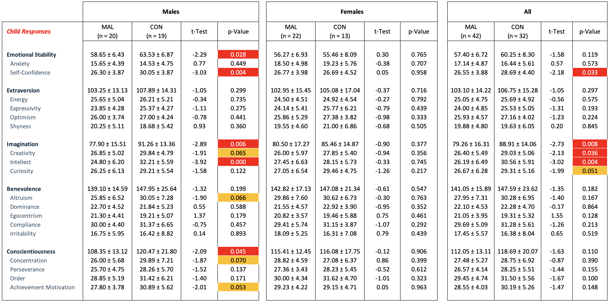
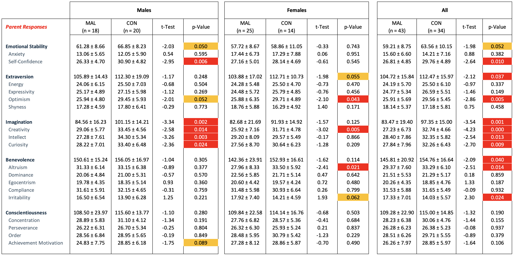
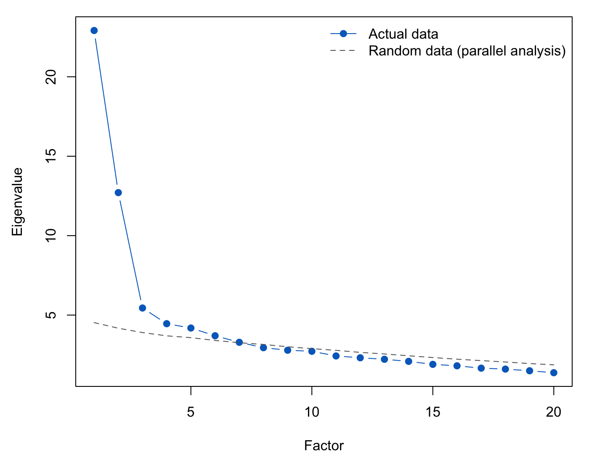
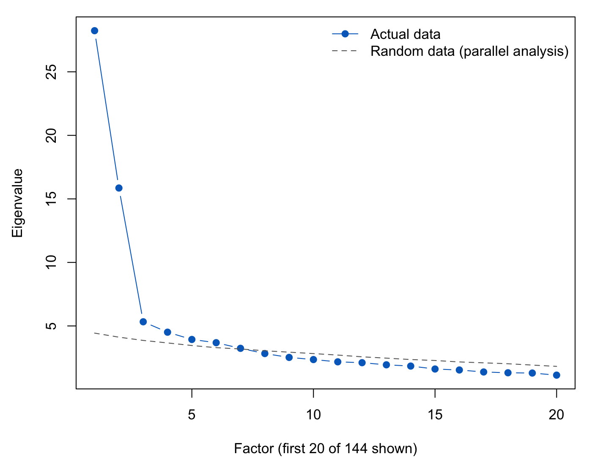
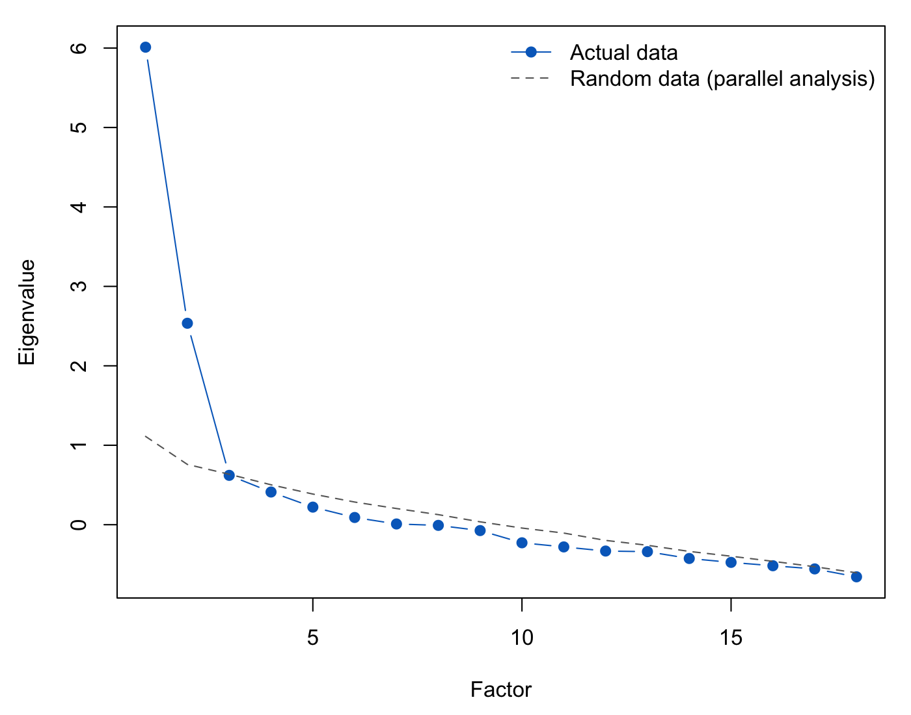
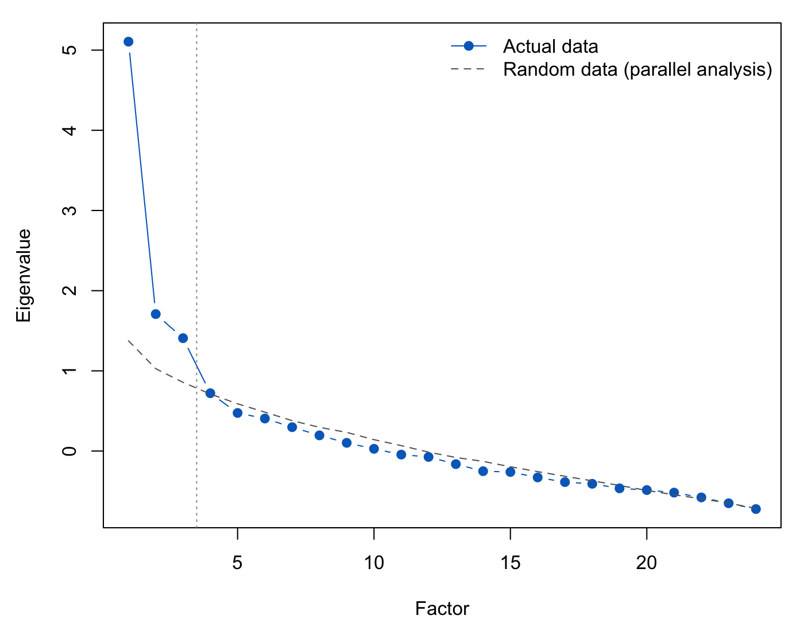

---
# YAML HEADER

title: "HiPIC Exploratory Analysis"
subtitle: "Trying to create a customized deck with xaringanthemer"  
knit: (function(input, ...) rmarkdown::render(input, output_file = "hipic-update.html"))
author:  "Kevin Williams"
date: '`r Sys.Date()`'
output:
  
  xaringan::moon_reader: 
    css: 
       - "xaringan-themer.css"
#       - "_css/kevin_css.css"
      
    seal: false                     # Prevents Moonreader from Generating a title page
    nature: 
        highlightLines: true        # Code for Highlighting text
        highlightStyle: github      # Highlighting syntax for code
        highlightSpans: true
        ratio: "16:9"                # FIXED: was 4;3 (ignored, so slides fell back to 16:9). Try "16:9" later to compare.
        # self_contained: false
        slideNumberFormat: "%current%"  # Slide number format
        countIncrementalSlides: false  
    
    lib_dir: libs
    
--- 
class: title-slide, left,middle, left, inverse, hide-count


background-image: linear-gradient(rgba(60,60,140,.55), rgba(60,60,140,.55)), url(images/title-bg.jpg)
<!-- background-image: linear-gradient(rgba(60,60,140,.55), rgba(60,60,140,.55)), url(images/austin-pacheco-FtL07GM9Q7Y-unsplash.jpg) -->
background-size: cover

```{r xaringan-themer, include=FALSE, warning=FALSE}

library(xaringanthemer)
library(psych)

style_duo_accent(
  
  primary_color = "#006cc5",
  secondary_color = "#ccdbee",
    
  # fonts
  # FIXED: Helvetica Neue is not a Google Font, so it is now named as a system font,
  #        with fallbacks for machines that don't have it (e.g. Windows -> Arial).
  header_font_family = "'Helvetica Neue', Helvetica, Arial, sans-serif",
  text_font_family   = "'Helvetica Neue', Helvetica, Arial, sans-serif",
  code_font_google = google_font("Fira Mono"),
  
  # H1-H3 font sizes
  header_h1_font_size= "2.5rem",
  header_h2_font_size = "2.0rem",
  header_h3_font_size = "1.85rem",
  base_font_size =      "1.15rem",
  
  code_font_size=       "0.55rem",
  # code_inline_background_color =  "0.55rem",   # FIXED: needs a colour, not a size; theme default now applies
  code_highlight_color = "rgb(0, 108, 197, 0.2)",

  
  #colors
  inverse_header_color=           "#FFFFFF",
  inverse_link_color=             "#ef8de4",
  title_slide_text_color=         "#FFFFFF",
  title_slide_background_color=   "#ec9120",
  header_background_color=        "#006cc5",
  header_background_text_color=   "#006cc5",
  header_color=                   "#006cc5",
  link_color =                    "#ef8de4",
  black = "#000000",
  white = "#FFFFFF"
  
)
  
  
```


```{r setup, include=FALSE}
options(htmltools.dir.version = FALSE)   # FIXED: removed warning = FALSE (not a real R option; opts_chunk below handles warnings)

knitr::opts_chunk$set(
  fig.width=9, fig.height=3.5, 
  fig.retina=3, 
  dpi=300,
  out.width = "100%",
  cache = FALSE,
  echo = TRUE,
  message = FALSE, 
  warning = FALSE,
  hiline = TRUE
  
)
```

```{css echo=FALSE}


.hide-count .remark-slide-number {
  display: none;
}

.hide-count-title  .title-slide-number {
  display: none;
}

/* FIXED: removed quotes around the colour (quoted values are invalid CSS, so the rule was ignored) */
.table-hover > tbody > tr:hover { 
  background-color: #ccdbee;
}


.arrow
{
  position:absolute;
  top: 290px;
  right: 160px;
  z-index: 2;
}

.bigx
{
  position:absolute;
  top: 100px;
  right: 200px;
  z-index: 2;
}


.smallx
{
  position:absolute;
  top: 78px;
  right: 175px;
  z-index: 2;
}


.oval1
{
  position:absolute;
  top: 31px;
  right: 165px;
  z-index: 2;
}

.childemoji
{
  position:absolute;
  top: 180px;
  left: 250px;
  opacity: 0.75;
  z-index: 2;
}


.senioremoji
{
  position:absolute;
  top: 180px;
  right: 300px;
  opacity: 1;
  z-index: 2;
}

.rlogo-watermark {
  position: absolute;
  bottom: 75px;
  left: 50%;
  transform: translateX(-50%);   /* centres it horizontally */
  opacity: 0.075;                  /* 0 = invisible, 1 = solid */
}

.rlogo-watermark2 {
  position: absolute;
  bottom: 40px;
  left: 50%;
  transform: translateX(-50%);   /* centres it horizontally */
  opacity: 0.10;                  /* 0 = invisible, 1 = solid */
}

.pink { color: #ef8de4; }
.ltblue {color: #8cc0f0}

.footnote-center {
  position: absolute;
  bottom: 6em;          /* raise or lower the footnote */
  left: 0;
  right: 0;
  text-align: center;
  font-size: 0.9em;
}


.pull-left h3, .pull-right h3 {
  font-size: 1.4rem;    /* adjust to taste */
}


.blue { color: #006cc5; }


.crosswalk td, .crosswalk th {
  padding: 4px 20px;          /* 4px above/below, 20px left/right: increase the 20 for more space */
}

.crosswalk tbody tr:nth-child(8) td {
  border-bottom: 2px solid #cbcccb;   /* grey line under row 8 */
}


.facet-cmp td, .facet-cmp th {
  padding: 3px 10px;        /* space above/below, and left/right, inside each cell */
  line-height: 1.15;        /* tighter line spacing within a row */
}

.facet-cmp table {
  margin-left: 0;           /* start each table at the left of its column */
}


.facet-cmp h2 { margin-bottom: 0.75em; }    /* space below the blue title */
.facet-cmp h5 { margin-top: 0.6em; 
                margin-bottom: 0.6em; }       /* space above the column headings */


ul li ul, ol li ul {
  margin-top: 5px; /* Adjust this value to get the perfect gap */
}

.cmp-table td, .cmp-table th { padding: 6px 6px; vertical-align: center; text-align: center; }
.cmp-table { font-size: 90%; margin-left: auto; margin-right: auto; width: 90%; }
.cmp-table td:first-child { text-align: left; width=22% }

.item-cmp table { font-size: 75%; table-layout: fixed; } 

.item-cmp td, .item-cmp th { padding: 3px 10px; }

/* .item-cmp table { font-size: 75%; width: 75%; table-layout: fixed; } */

.kmo-slide .remark-code { font-size: 60%; }

.gd-table table { font-size: 55%; }
.gd-table td, .gd-table th { padding: 2px 8px; }


/* Add to the deck's CSS chunk. */

/* One-line notes under a slide title (panel slide, table slide, no-counterpart slide) */
.small-note { font-size: 60%; margin: 0.2em 0 0.6em 0; }

/* Interactive HiPIC-BFI-2 table: shrink everything DT draws, including the filter boxes */
.map-table .dataTables_wrapper { font-size: 55%; }
.map-table table.dataTable td,
.map-table table.dataTable th { padding: 3px 6px; vertical-align: top; }
.map-table .dataTables_wrapper input,
.map-table .dataTables_wrapper select { font-size: 90%; }


.note {
  font-size: 0.7rem;      /* rem: the same size on every slide, whatever it's nested in */
  text-align: center;
  margin-top: 1em;
}


.note-standard {
 
  text-align: center;
  margin-top: 1em;
}


.load-cmp table { font-size: 75%; }
.load-cmp td, .load-cmp th { padding: 1px 8px; }

.alpha-slide table { font-size: 80%; }
.alpha-slide td, .alpha-slide th { padding: 2px 8px; }
.alpha-slide .remark-code { font-size: 55%; }
.alpha-slide .pull-right { font-size: 90%; }


```

```{r xaringanExtra, echo=FALSE}
xaringanExtra::use_xaringan_extra(c("tile_view", "animate_css", "panelset"))

# xaringanExtra::use_xaringan_extra(c("tile_view", "animate_css", "panelset", "tile", "scribble"))
```


# HiPIC Exploratory Analysis
### Hierarchical Personality Inventory for Children
### <br>
### USING THE R PROGRAMMING LANGUAGE
#### Prepared by Kevin Williams  | Preliminary Findings   |   October 30, 2026
#### Updated `r Sys.Date()`
#### <br>

---
layout: true
<!-- background-image: url(https://i.imgur.com/5rlX8bi.png) -->
background-image: url(images/statistikboden_lblå.svg)
background-position: 2% 98.5%
background-size: 60px 60px

---
## So why redo this in R?


<center></center>

---
## So why redo this in R?

1. Excellent <font color="#006cc5">**learning opportunity**</font>

--

1. Provides another chance to <font color="#006cc5">**validate SAS results**</font> prior to publication

--

1. R provides a wider variety of add-on packages that can enhance preliminary output - <font color="#006cc5">**makes sharing with collaborators fun**</font>

--

1. Data scientists — particularly in the social sciences — have made a marked <font color="#006cc5">**shift to R and Python**</font> and away from SAS and SPSS

--
1. Among the  <font color="#006cc5">**R packages**</font> to be used in this analysis include:

    - <font color="#006cc5">haven</font> and <font color="#006cc5">openxlsx2</font> for importing and exporting raw data and SAS datasets from prior work
    - <font color="#006cc5">tidyverse,</font> which includes packages like dplyr, magrittr, and ggplot, all helpful with data wrangling and beautification
    - <font color="#006cc5">statx</font> and <font color="#006cc5">misty</font> for general descriptive statistical calculations
    - <font color="#006cc5">psych</font> and <font color="#006cc5">lavaan</font> for more complex principal components and factor analyses

<br>


<!--  -->

<!-- FIXED: closing tags above were </font color> (now </font>); the image below had a doubled quote and never loaded. -->
<!-- NOTE: now that it loads, a 350px image under four bullets will likely run off the slide; delete or shrink if so. -->


---
class: hide-count, inverse
background-image: linear-gradient(rgba(15,34,64,.45), rgba(15,34,64,.45)), url(images/luke-jones-tBvF46kmwBw-unsplash.jpg)
background-size: cover


## Task No. 1
### Import the SAS datasets containing the .pink[Child Self-Report] and .pink[Parental Report] raw scores, and prepare an overview of the two populations.

<!-- TODO: the link above is a placeholder; replace with the real URL (e.g. GitHub) -->


---
## Data Clean-Up

.panelset[
.panel[.panel-name[Import Data]

```{r Data-Cleanup-Import, eval=F}


require(readr)      # use if importing a comma- or tab-delimited dataset #
require(haven)      # if importing a SAS dataset #
require(openxlsx2)  # if exporting to an Excel workbook#


CHILD_RAW   <- read_sas("/Volumes/FDrive/AllQsbyQ/HIPIC/allhipic_c.sas7bdat")
PARENT_RAW  <- read_sas("/Volumes/FDrive/AllQsbyQ/HIPIC/allhipic_p.sas7bdat")


# make.names function essentially replaces all spaces and non-standard characters
# (parens, brackets, etc.) with a series of periods - very helpful if importing a non-standard format


DSN <- c(CHILD_RAW, PARENT_RAW)        
                                       
for (x in DSN) {                                       #<<
                                                      #<<
names(x)  <-  make.names( names(x), unique= TRUE) }   #<<


```
]

.panel[.panel-name[Investigate Missingness]

Here's area few code snippets from the  <font color="#006cc5">**dplyr**</font color> and <font color="#006cc5">**magrittr**</font color> packages that we used to wrangle our data:
```{r Data-Cleanup-Missing, eval=F}


require(tidyverse)
require(magrittr)  

# Dimensions of the original datasets
dim(CHILD_RAW)
dim(PARENT_RAW)

# Total missing values across all variables
sum(is.na(CHILD_RAW))
sum(is.na(PARENT_RAW))

# Number of observations containing at least one missing value
sum(!complete.cases(CHILD_RAW))  #<<
sum(!complete.cases(PARENT_RAW)) #<<


# Missingness - Child
CHILD_MISSING <- CHILD_RAW %>%
  mutate(N_MISSING = rowSums(is.na(pick(11:154)))) %>%
  filter(N_MISSING > 0) %>%
  select(ID4, DOE, N_MISSING)

# Missingness - Parent
PARENT_MISSING <- PARENT_RAW %>%
  mutate(N_MISSING = rowSums(is.na(pick(13:156)))) %>%
  filter(N_MISSING > 0) %>%
  select(ID4, DOE, N_MISSING)

```
]


.panel[.panel-name[Simple Imputation]

Exclude any observation with more than 2% missing values, and impute values using <font color="#006cc5">**mean substitute**</font color> based on averages from the <font color="#006cc5">**CVPK * MVF**</font color> by group:
```{r Data-Cleanup-Impute, eval=F}


# excluding based on values in a vector

CHILD_EXCLUDE   <- CHILD_MISSING %>%  filter( N_MISSING >= 3 | is.na(DOE)) %>% pull(ID4)
PARENT_EXCLUDE  <- PARENT_MISSING %>% filter( N_MISSING >= 3 | is.na(DOE)) %>% pull(ID4)

CHILD <-  CHILD_RAW %>%  filter( !ID4 %in% CHILD_EXCLUDE)
PARENT <- PARENT_RAW %>% filter( !ID4 %in% PARENT_EXCLUDE)


# Use the GROUPBY and ACROSS functions to find the CVPK/MVF mean and then apply those to questions that are missing:
# Code used for the CHILD dataset was repeated for the PARENT dataset

CHILD <- CHILD %>%
  group_by(CVPK, MVF) %>%
  mutate(across(last_col(offset = 143):last_col(),
                function(x) {
                  ifelse(is.na(x),
                         round(mean(x, na.rm = TRUE)),
                         x)
                })) %>%  ungroup()


#Confirm no missing values .....

sum(!complete.cases(CHILD))   #<<
sum(!complete.cases(PARENT))  #<<

```
]
]


---

## Descriptive Stats

.pull-left[
### Child Self-Report

```{r tab-child, echo=FALSE}
knitr::kable(readRDS("tab_child.rds"), format = "html",
             align     = c("l", "c", "c", "c"),
             col.names = c("", "MAL", "CON", "<em>p</em>"),
             escape    = FALSE,
             table.attr = 'style="font-size: 90%; margin-left: 0;"')
```
]

.pull-right[
### Parent Report

```{r tab-parent, echo=FALSE}
knitr::kable(readRDS("tab_parent.rds"), format = "html",
             align     = c("l", "c", "c", "c"),
             col.names = c("", "MAL", "CON", "<em>p</em>"),
             escape    = FALSE,
             table.attr = 'style="font-size: 90%; margin-left: 0;"')
```
]


.footnote-center[p-values: Original and final N, χ² goodness-of-fit against a 50:50 split; missing items,<br>Fisher's exact test; age, Welch t-test; sex, Pearson χ².]


---
class: hide-count, inverse
background-image: linear-gradient(rgba(15,34,64,.45), rgba(15,34,64,.45)), url(images/luke-jones-tBvF46kmwBw-unsplash.jpg)
background-size: cover


## Task No. 2
### Examine the responses in the .pink[Child Self-Report] and .pink[Parental Report] and perform any necessary data clean-up, and prepare for evaluation using the HiPIC scoring key.


---

## Data Preparation

- .blue[**Equivalent Items:**] All 144 items appear on both forms, differing only in perspective — first person on the Child form ("I talk to people easily") and third person on the Parent form ("Talks to people easily").

- .blue[**Different Item Order:**] The Child form spreads each facet's items across the questionnaire, whereas the Parent form groups related items together.

- .blue[**Realignment:**] Parent items were renumbered to the corresponding positions on the Child form using a crosswalk, allowing a single scoring key to assign every item on each instrument to the correct facet and domain.

- .blue[**Reverse Scoring:**] The 36 reverse-keyed items were rescored as $x' = 6 - x$, where $x$ is the original response (1–5).

- .blue[**Missing Responses:**] Remaining missing answers (respondents with fewer than 3 missing items) were replaced with the item mean for the respondent's nutritional group × sex subgroup, rounded to the nearest whole response.


---
class: crosswalk

## Data Preparation, cont.
```{r tab-crosswalk, echo=FALSE}
knitr::kable(readRDS("tab_crosswalk.rds"), format = "html",
             align      = c("c", "l", "c", "l", "l"),
             table.attr = 'style="font-size: 75%;"')
```


---
class: hide-count, inverse
background-image: linear-gradient(rgba(15,34,64,.45), rgba(15,34,64,.45)), url(images/luke-jones-tBvF46kmwBw-unsplash.jpg)
background-size: cover


## Task No. 3
### Review .pink[Mean Differences by Nutritional Group] (PEM vs. Controls) for both instruments, reporting data separately by sex.


---
exclude: true

## Group Differences: <a href="https://1drv.ms/x/c/fe758b52557a37db/IQDerhxwhXmySIeEtrJO6eXcAYlTxwjbuAzmltC5tn2dU24?e=yH75tx&nav=MTJfQjM4X3swMDAwMDAwMC0wMDAxLTAwMDAtMDQwMC0wMDAwMDAwMDAwMDB9" target="_blank" style="color: #8cc0f0; text-decoration: underline solid;">  Child Self-Report</a>




<p style="text-align: center; font-size: 0.65em; margin-top: 0.8em;">
Mean ± SD; Welch t-tests. Red: <i>p</i> < .05; yellow: .05 ≤ <i>p</i> < .10. Not adjusted for multiple comparisons.
</p>


---
class: gd-table

## Group Differences: <a href="https://1drv.ms/x/c/fe758b52557a37db/IQDerhxwhXmySIeEtrJO6eXcAYlTxwjbuAzmltC5tn2dU24?e=yH75tx&nav=MTJfQjM4X3swMDAwMDAwMC0wMDAxLTAwMDAtMDQwMC0wMDAwMDAwMDAwMDB9" target="_blank" style="color: #8cc0f0; text-decoration: underline solid;">  Child Self-Report</a>

```{r child-self-report-redux, echo=FALSE, message=FALSE, warning=FALSE }


BASEC <- readRDS("cbase_wide.rds")

    CSUMMARY <- NULL  
    
    for (x in 0:2) {
      
      LABEL <- c("Males", "Females", "All")[x + 1]        # 0 -> Males, 1 -> Females, 2 -> All
      
      temp <- BASEC %>%
        filter(as.numeric(MODEL) == x) %>%
        group_by(MODEL, VARNAME) %>%
        summarise(
          MAL = sprintf("%.2f ± %.2f", MAL[`_STAT_` == "MEAN"], MAL[`_STAT_` == "STD"]),
          CON = sprintf("%.2f ± %.2f", CON[`_STAT_` == "MEAN"], CON[`_STAT_` == "STD"]),
          t   = round(ALL[`_STAT_` == "TTEST WELCH"], 2),
          p   = round(ALL[`_STAT_` == "PVALUE"], 3),
          .groups = "drop") %>%
        select(-MODEL) %>%                                   # the block's label replaces MODEL
        rename_with(~ paste(LABEL, .x), c(MAL, CON, t, p))   # e.g. "Males MAL", "Females p"
      

       CSUMMARY <- if (x == 0) temp else cbind(CSUMMARY, select(temp, -VARNAME))
    }
    

    LABELS <- c(BE     = "BENEVOLENCE",
                BE_ALT = "Altruism",
                BE_COM = "Compliance",
                BE_DOM = "Dominance",
                BE_EGO = "Egocentrism",
                BE_IRR = "Irritability",
                CO     = "CONSCIENTIOUSNESS",
                CO_ACH = "Achievement",
                CO_CNC = "Concentration",
                CO_ORD = "Order",
                CO_PER = "Perseverance",
                ES     = "EMOTIONAL STABILITY",
                ES_ANX = "Anxiety",
                ES_CON = "Self-Confidence",
                EX     = "EXTRAVERSION",
                EX_ENE = "Energy",
                EX_EXP = "Expressiveness",
                EX_OPT = "Optimism",
                EX_SHY = "Shyness",
                IM     = "IMAGINATION",
                IM_CRE = "Creativity",
                IM_CUR = "Curiosity",
                IM_INT = "Intellect")
    
    CSUMMARY$VARNAME <- unname(LABELS[CSUMMARY$VARNAME])
    
    
    
    library(kableExtra)
    
    p_bg <- function(p) ifelse(p < .05, "#d73027", ifelse(p < .10, "orange", "white"))   # background
    p_fg <- function(p) ifelse(p < .05, "white", "black")                                 # text colour
    
DOM <- which(CSUMMARY$VARNAME == toupper(CSUMMARY$VARNAME))   # rows 1, 7, 12, 15, 20
FAC <- setdiff(seq_len(nrow(CSUMMARY)), DOM)                  # all the other rows

TAB <- CSUMMARY %>%
  kbl(col.names = c("Variable", rep(c("MAL", "CON", "t", "p-Value"), 3)),
      align = c("l", rep("c", 12))) %>%
  kable_styling(full_width = FALSE) %>%
  add_header_above(c(" " = 1, "Males" = 4, "Females" = 4, "All" = 4)) %>%
  column_spec(c(1, 5, 9), border_right = TRUE) %>%
  row_spec(DOM, bold = TRUE) %>%                                         # bold domains
  row_spec(DOM[-1], extra_css = "border-top: 1px solid #666;") %>%      # line above each new domain
  add_indent(FAC)                                                        # indent facets

for (j in c(5, 9, 13)) {
  TAB <- column_spec(TAB, j, background = p_bg(CSUMMARY[[j]]), color = p_fg(CSUMMARY[[j]]))
}

TAB


```

<p style="text-align: center; font-size: 0.65em; margin-top: 0.8em;">
Mean ± SD; Welch t-tests. Red: <i>p</i> < .05; yellow: .05 ≤ <i>p</i> < .10. Not adjusted for multiple comparisons.
</p>
---
exclude: true


## Group Differences: <a href="https://1drv.ms/x/c/fe758b52557a37db/IQDerhxwhXmySIeEtrJO6eXcAYlTxwjbuAzmltC5tn2dU24?e=3mJv4t&nav=MTJfQjVfezAwMDAwMDAwLTAwMDEtMDAwMC0wNDAwLTAwMDAwMDAwMDAwMH0" target="_blank" style="color: #8cc0f0; text-decoration: underline solid;">  Parent Report</a>



<p style="text-align: center; font-size: 0.65em; margin-top: 0.8em;">
Mean ± SD; Welch t-tests. Red: <i>p</i> < .05; yellow: .05 ≤ <i>p</i> < .10. Not adjusted for multiple comparisons.
</p>


---
class: gd-table

## Group Differences: <a href="https://1drv.ms/x/c/fe758b52557a37db/IQDerhxwhXmySIeEtrJO6eXcAYlTxwjbuAzmltC5tn2dU24?e=3mJv4t&nav=MTJfQjVfezAwMDAwMDAwLTAwMDEtMDAwMC0wNDAwLTAwMDAwMDAwMDAwMH0" target="_blank" style="color: #8cc0f0; text-decoration: underline solid;">  Parent Report</a>

```{r parent-self-report-redux, echo=FALSE, message=FALSE, warning=FALSE }


BASEP <- readRDS("pbase_wide.rds")

    PSUMMARY <- NULL  
    
    for (x in 0:2) {
      
      LABEL <- c("Males", "Females", "All")[x + 1]        # 0 -> Males, 1 -> Females, 2 -> All
      
      temp <- BASEP %>%
        filter(as.numeric(MODEL) == x) %>%
        group_by(MODEL, VARNAME) %>%
        summarise(
          MAL = sprintf("%.2f ± %.2f", MAL[`_STAT_` == "MEAN"], MAL[`_STAT_` == "STD"]),
          CON = sprintf("%.2f ± %.2f", CON[`_STAT_` == "MEAN"], CON[`_STAT_` == "STD"]),
          t   = round(ALL[`_STAT_` == "TTEST WELCH"], 2),
          p   = round(ALL[`_STAT_` == "PVALUE"], 3),
          .groups = "drop") %>%
        select(-MODEL) %>%                                   # the block's label replaces MODEL
        rename_with(~ paste(LABEL, .x), c(MAL, CON, t, p))   # e.g. "Males MAL", "Females p"
      

       PSUMMARY <- if (x == 0) temp else cbind(PSUMMARY, select(temp, -VARNAME))
    }
    

    LABELS <- c(BE     = "BENEVOLENCE",
                BE_ALT = "Altruism",
                BE_COM = "Compliance",
                BE_DOM = "Dominance",
                BE_EGO = "Egocentrism",
                BE_IRR = "Irritability",
                CO     = "CONSCIENTIOUSNESS",
                CO_ACH = "Achievement",
                CO_CNC = "Concentration",
                CO_ORD = "Order",
                CO_PER = "Perseverance",
                ES     = "EMOTIONAL STABILITY",
                ES_ANX = "Anxiety",
                ES_CON = "Self-Confidence",
                EX     = "EXTRAVERSION",
                EX_ENE = "Energy",
                EX_EXP = "Expressiveness",
                EX_OPT = "Optimism",
                EX_SHY = "Shyness",
                IM     = "IMAGINATION",
                IM_CRE = "Creativity",
                IM_CUR = "Curiosity",
                IM_INT = "Intellect")
    
    PSUMMARY$VARNAME <- unname(LABELS[PSUMMARY$VARNAME])
    
    
    
    library(kableExtra)
    
    p_bg <- function(p) ifelse(p < .05, "#d73027", ifelse(p < .10, "orange", "white"))   # background
    p_fg <- function(p) ifelse(p < .05, "white", "black")                                 # text colour
    
DOM <- which(PSUMMARY$VARNAME == toupper(PSUMMARY$VARNAME))   # rows 1, 7, 12, 15, 20
FAC <- setdiff(seq_len(nrow(PSUMMARY)), DOM)                  # all the other rows

TAB <- PSUMMARY %>%
  kbl(col.names = c("Variable", rep(c("MAL", "CON", "t", "p-Value"), 3)),
      align = c("l", rep("c", 12))) %>%
  kable_styling(full_width = FALSE) %>%
  add_header_above(c(" " = 1, "Males" = 4, "Females" = 4, "All" = 4)) %>%
  column_spec(c(1, 5, 9), border_right = TRUE) %>%
  row_spec(DOM, bold = TRUE) %>%                                         # bold domains
  row_spec(DOM[-1], extra_css = "border-top: 1px solid #666;") %>%      # line above each new domain
  add_indent(FAC)                                                        # indent facets

for (j in c(5, 9, 13)) {
  TAB <- column_spec(TAB, j, background = p_bg(PSUMMARY[[j]]), color = p_fg(PSUMMARY[[j]]))
}

TAB


```

<p style="text-align: center; font-size: 0.65em; margin-top: 0.8em;">
Mean ± SD; Welch t-tests. Red: <i>p</i> < .05; yellow: .05 ≤ <i>p</i> < .10. Not adjusted for multiple comparisons.
</p>

---
class: hide-count, inverse
background-image: linear-gradient(rgba(15,34,64,.45), rgba(15,34,64,.45)), url(images/luke-jones-tBvF46kmwBw-unsplash.jpg)
background-size: cover


## Task No. 4
### Examine the structure underlying the 144 HiPIC items to assess whether the Domain and Facet data can support a .pink[Factor Analysis,] and how many factors the data suggest.
---

## Sample Size & Factorability

- .blue[**The Goal:**] Identify the structure underlying the 144 HiPIC items, without assuming any scoring key in advance.

- .blue[**The Sample:**] With fewer respondents than items — 74 children and 77 parents for 144 items — every item correlation rests on the same few dozen people:

$$\frac{p\,(p-1)}{2} = \frac{144 \times 143}{2} = 10{,}296 \text{ unique correlations}$$

- .blue[**The Precision:**] Each correlation is estimated with considerable noise; at n = 74, a true correlation of zero can appear as large as:

$$\pm \frac{1.96}{\sqrt{n}} = \pm \frac{1.96}{\sqrt{74}} \approx \pm .23$$

- .blue[**What That Means:**] Together, the correlations can describe at most 73 (children) and 76 (parents) independent dimensions, so standard adequacy tests (KMO, Bartlett's) cannot be computed at item level.

- .blue[**Our Approach:**] Item-level results are treated as exploratory, using methods suited to this situation, with the number of factors checked by parallel analysis.

- .blue[**A Second Lens:**] At facet level, the standard tests apply, and the data are clearly suitable (KMO = .85 children, .80 parents), providing a firmer result alongside the exploratory one.


---


## Scree Plot & Eigenvalues - Child Self-Report


.pull-left[

]

.pull-right[
```{r eig-child, echo=FALSE}
knitr::kable(readRDS("eig_child.rds"), format = "html",
             align = "c", table.attr = 'style="font-size: 75%; margin-top: 2em;"')
```
]

---

## Scree Plot & Eigenvalues - Parent Report

.pull-left[

]

.pull-right[
```{r eig-parent, echo=FALSE}
knitr::kable(readRDS("eig_parent.rds"), format = "html",
             align = "c", table.attr = 'style="font-size: 75%;"')
```

<p style="text-align: center; font-size: 0.6em; margin-top: 0.8em;">
Parallel analysis retains 6 factors (actual eigenvalues above random).<br>Table: eigenvalues of the correlation matrix; plot: factor-analysis eigenvalues.
</p>
]

---

## How Many Factors?

| Guide | Suggests | Basis |
|:--|:--:|:--|
| Scree Elbow | 2–3 | Where the eigenvalue curve flattens |
| Parallel Analysis | 6 | Factors whose eigenvalues exceed those of random data |
| Theory (HiPIC & NEO) | 5 | Both models specify five domains |

- .blue[**Our Choice:**] Five factors, the number both models predict and the structure under test, with six examined as a sensitivity check.


---
## Prepare for Factor Analysis using psych() package

.panelset[
.panel[.panel-name[Create Variable Matrices]

```{r FA-PREP-Psych-1, eval=F}


require(psych)  

# 144 items per sample (reverse-scored, imputed)
C_ITEMS <- CHILD_REVERSED  %>% select(last_col(offset = 143):last_col())  #<<
P_ITEMS <- PARENT_REVERSED %>% select(last_col(offset = 143):last_col())  #<<

# item-level eigenvalues (correlation matrix)
EV_C <- eigen(cor(C_ITEMS))$values
EV_P <- eigen(cor(P_ITEMS))$values


# 18 facets per sample (domain totals excluded)
C_FACETS <- CHILD_SCORED  %>% select(matches("^(ES|EX|IM|BE|CO)_"))
P_FACETS <- PARENT_SCORED %>% select(matches("^(ES|EX|IM|BE|CO)_"))


```
]

.panel[.panel-name[Practice FA Syntax]
```{r FA-PREP-Pscyh-2, eval=F}


# Sample function calls for item-level factor solutions


# Rotation vs. Non-Rotation using Min Res estimations
FA5_PNOROT  <- psych::fa(P_ITEMS, nfactors = 5, fm = "minres", rotate = "none")    #<<
FA5_PVMAX   <- psych::fa(P_ITEMS, nfactors = 5, fm = "minres", rotate = "varimax") #<<


# Orthoganal Rotations mirroring SAS default settings for factor analyses
FA5_PVMAX_SAS   <- psych::fa(P_ITEMS, nfactors = 5, fm = "pa", rotate = "varimax")    #<<
FA2_PVMAX_SAS   <- psych::fa(P_ITEMS, nfactors = 2, fm = "pa", rotate = "varimax")    #<<


# Orthoganol Rotation (Varimax) vs. Oblique Rotation (Promax) using Maximum Likelhood estimations
FA2_CVMAX   <- psych::fa(C_ITEMS, nfactors = 2, fm = "ML", rotate = "none")   #<<
FA2_COBLQ   <- psych::fa(C_ITEMS, nfactors = 2, fm = "ML", rotate = "promax")  #<<


```
]
]


---

## Five-Factor Solution (Varimax): Child Self-Report

| Factor | % Var | Defining Items | Interpretation |
|:--|:--:|:--|:--|
| F1 | 13.6 | Perseveres, understands quickly, defends the weak, sees the sunny side | Broad positive self-description, spanning all domains |
| F2 | 7.9 | Acts like the boss, lashes out, manipulates; makes a mess, gives up (reversed) | Problem behaviour, spanning several domains |
| F3 | 5.8 | Afraid of failure, quick to worry, easily depressed | Anxiety |
| F4 | 4.3 | Confident, rich imagination, notices everything | Intellect / imagination |
| F5 | 3.7 | Talks about feelings, talks all day, makes others laugh | Expressiveness |

---

## Five-Factor Solution (Varimax): Child Self-Report, cont.

.pull-left[
```{r top-child-1, echo=FALSE}
knitr::kable(readRDS("top_load_child.rds")[1:20, ], format = "html",
             align = c("c", "l", rep("c", 5)),
             table.attr = 'style="font-size: 55%;"')
```
]

.pull-right[
```{r top-child-2, echo=FALSE}
knitr::kable(readRDS("top_load_child.rds")[21:30, ], format = "html",
             align = c("c", "l", rep("c", 5)),
             table.attr = 'style="font-size: 55%;"')
```
<br>
<p style="text-align: center; font-size: 0.6em; margin-top: 0.8em;">
Top 10 items per factor shown (F1–F3); loadings below .30 not shown.<br>Full loadings in the accompanying <a href="https://1drv.ms/x/c/fe758b52557a37db/IQDerhxwhXmySIeEtrJO6eXcAYlTxwjbuAzmltC5tn2dU24?e=lquYhH&nav=MTJfQjI6QzJfezAwMDAwMDAwLTAwMDEtMDAwMC0wNzAwLTAwMDAwMDAwMDAwMH0" target="_blank">Excel file</a>.
</p>
]

---

## Five-Factor Solution (Varimax): Child Self-Report, cont.

```{r top-child-3, echo=FALSE}
knitr::kable(readRDS("top_load_child.rds")[31:49, ], format = "html",
             align = c("c", "l", rep("c", 5)),
             table.attr = 'style="font-size: 55%;"')
```

<p style="text-align: center; font-size: 0.6em; margin-top: 0.8em;">
F4: top 10 items shown. F5: all 9 items loading ≥ .30 shown. Loadings below .30 not shown.<br>Full loadings in the accompanying <a href="https://1drv.ms/x/c/fe758b52557a37db/IQDerhxwhXmySIeEtrJO6eXcAYlTxwjbuAzmltC5tn2dU24?e=lquYhH&nav=MTJfQjI6QzJfezAwMDAwMDAwLTAwMDEtMDAwMC0wNzAwLTAwMDAwMDAwMDAwMH0" target="_blank">Excel file</a>.
</p>


---

## Five-Factor Solution (Varimax): Parent Report

| Factor | % Var | Defining Items | Interpretation |
|:--|:--:|:--|:--|
| F1 | 18.4 | Expresses self well, likes to learn, wants to shine, has confidence | Competence / overall impression, spanning domains |
| F2 | 7.6 | Quick to panic, quick to worry, afraid of failure, cries over setbacks | Anxiety |
| F3 | 6.9 | Quick to argue, lashes out, finds it hard to share, gets own way | Antagonism |
| F4 | 5.0 | Goes laughing through life, has plenty of nerve, bursts with enthusiasm | Extraversion |
| F5 | 3.1 | Shows concern for other children | Altruism (weak: only 2 items load primarily here) |


---

## Five-Factor Solution (Varimax): Parent Report, cont.

.pull-left[
```{r top-parent-1, echo=FALSE}
knitr::kable(readRDS("top_load_parent.rds")[1:20, ], format = "html",
             align = c("c", "l", rep("c", 5)),
             table.attr = 'style="font-size: 55%;"')
```
]

.pull-right[
```{r top-parent-2, echo=FALSE}
knitr::kable(readRDS("top_load_parent.rds")[21:30, ], format = "html",
             align = c("c", "l", rep("c", 5)),
             table.attr = 'style="font-size: 55%;"')
```

<br>
<p style="text-align: center; font-size: 0.6em; margin-top: 0.8em;">
Top 10 items per factor shown; loadings below .30 not shown.<br>Full loadings in the accompanying <a href="https://1drv.ms/x/c/fe758b52557a37db/IQDerhxwhXmySIeEtrJO6eXcAYlTxwjbuAzmltC5tn2dU24?e=SuX8hW&nav=MTJfQjI6QzJfezAwMDAwMDAwLTAwMDEtMDAwMC0wNTAwLTAwMDAwMDAwMDAwMH0" target="_blank" >Excel file</a>.
</p>
]

---

## Five-Factor Solution (Varimax): Parent Report, cont.

```{r top-parent-3, echo=FALSE}
knitr::kable(readRDS("top_load_parent.rds")[31:42, ], format = "html",
             align = c("c", "l", rep("c", 5)),
             table.attr = 'style="font-size: 55%;"')
```

<p style="text-align: center; font-size: 0.6em; margin-top: 0.8em;">
Top 10 items per factor shown; loadings below .30 not shown.<br>Full loadings in the accompanying <a href="https://1drv.ms/x/c/fe758b52557a37db/IQDerhxwhXmySIeEtrJO6eXcAYlTxwjbuAzmltC5tn2dU24?e=SuX8hW&nav=MTJfQjI6QzJfezAwMDAwMDAwLTAwMDEtMDAwMC0wNTAwLTAwMDAwMDAwMDAwMH0" target="_blank" >Excel file</a>.
</p>


---

## Taking Stock:  Item-Level Results

- .blue[**What Emerged:**] Five factors explain 35% (children) and 41% (parents) of item variance, and several recognisable dimensions appear: anxiety, antagonism, intellect/imagination and extraversion.

- .blue[**A Pattern Worth Noting:**] The two largest factors each span all five domains. The first collects desirable items from every domain; the second largely follows scoring direction (in parents, all 61 items loading ≥ .30 point the same way in the original responses).

- .blue[**What It May Mean:**] Part of the item-level structure may reflect how respondents answer, such as a general impression of the child or a tendency to agree, alongside the personality content itself. Separating the two will need further analysis.

- .blue[**The Role of Sample Size:**] With fewer respondents than items, item-level loadings are imprecise, so these solutions are best treated as exploratory.

- .blue[**Why Facets Next:**] Facet scores combine positively and negatively worded items, which may partly offset these response tendencies. The facet data also meet standard adequacy criteria (KMO = .85 children, .80 parents), and facet-level analysis has been used in published work with similar instruments.

- .blue[**Next Step:**] Factor analysis at the facet level, including a comparison of the HiPIC and NEO domain structures.


---
class: hide-count, inverse
background-image: linear-gradient(rgba(15,34,64,.45), rgba(15,34,64,.45)), url(images/luke-jones-tBvF46kmwBw-unsplash.jpg)
background-size: cover


## Task No. 5
### Consider performing factor analysis on the .pink[Facet-level responses] to investigate whether the resulting components are interpretable. 
---


## Scree Plot & Eigenvalues: Parent Report (Facets)

.pull-left[

]

.pull-right[
```{r eig-parent-facets, echo=FALSE}
knitr::kable(readRDS("eig_facets_parent.rds"), format = "html",
             align = "c", table.attr = 'style="font-size: 75%;"')
```

<p style="text-align: center; font-size: 0.6em; margin-top: 0.8em;">
Parallel analysis retains 2 factors (actual eigenvalues above random).<br>Table: eigenvalues of the facet correlation matrix; plot: factor-analysis eigenvalues.
</p>
]

---
## How Many Factors for the Facets?

| Guide | Suggests | Basis |
|:--|:--:|:--|
| Scree Elbow | 2 | Where the eigenvalue curve flattens |
| Parallel Analysis | 2 | Factors whose eigenvalues exceed those of random data (both samples) |
| Theory (HiPIC & NEO) | 5 | Both models specify five domains |
<br>
- .blue[**Our Choice:**]  Run both. Two factors, the structure the data clearly support, and five factors, the structure both models predict, for comparison with the HiPIC and NEO domains and with published.  It may also be worthwhile to investiage the structures of the 3- and 4-factor models.

---
class: kmo-slide

## Run the Keiser-Meyer-Okin (KMO) suitability analysis

- The Keiser-Meyer-Okin measure (KMO) compares the correlations between facets with their **partial** correlations, what remains after removing the influence of all the other facets.

- When facets share common ground, the partial correlations are small and KMO approaches 1.

- It's calculated **overall** and **for each facet**. Bartlett's test adds a check that the facets are correlated at all.

```{r kmo-data, include=FALSE}

P_FACETS <- readRDS("kmo_facets_parent.rds")

```


``` {r kmo-data-cont }


R    <- cor(P_FACETS)                               # 18 x 18 facet correlations
KMOP <- KMO(R)   
BART <- cortest.bartlett(R, n = nrow(P_FACETS))     # Bartlett's test

# Overall
data.frame(KMO   = round(KMOP$MSA, 2),
           ChiSq = round(BART$chisq, 1),
           df    = BART$df,
           p     = format.pval(BART$p.value, eps = .001))

# Per facet, weakest first
sort(round(KMOP$MSAi, 2))

```


.note[KMO: above .80 = good, below .50 = unsuitable.]

---
## Two-Factor Solution (Varimax): Parent Report - Facets

```{r fac-parent-2, echo=FALSE}
options(knitr.kable.NA = "")


library(dplyr)
options(knitr.kable.NA = "")

TH  <- .40                                   # visibility threshold: change here
TAB <- readRDS("fac_p2.rds")
VAR <- TAB$Facet == "VAR EXPLAINED"          # marks the last row

TAB <- TAB %>%
  mutate(across(c(F1, F2), ~ ifelse(VAR, sprintf("%.3f", .x),
                              ifelse(abs(.x) >= TH,
                                     sprintf("<b>%.2f</b>", .x),
                                     sprintf('<span style="color:#bbbbbb;">%.2f</span>', .x)))))

knitr::kable(TAB, format = "html", escape = FALSE,
             align = c("l", "l", "l", "c", "c", "c", "c"),
             table.attr = 'style="font-size: 50%; margin-left: auto; margin-right: auto;"')
```

<p style="text-align: center; font-size: 0.6em; margin-top: 0.8em;">
Bold: |loading| ≥ .40; grey: below. Minres extraction, varimax rotation; 18 facets, n = 77.<br>Full results in the accompanying <a href="https://1drv.ms/x/c/fe758b52557a37db/IQDerhxwhXmySIeEtrJO6eXcAYlTxwjbuAzmltC5tn2dU24?e=uo2eUf&nav=MTJfQjI6QzJfezAwMDAwMDAwLTAwMDEtMDAwMC0xMTAwLTAwMDAwMDAwMDAwMH0" target="_blank">Excel file</a>.
</p>

---
class: facet-cmp
<!-- background-image: none -->

## Additional Varimax Factor Solutions: Parent Report (Facets)

```{r fac-parent-345, echo=FALSE}
library(dplyr)
options(knitr.kable.NA = "")

TH <- .40                                    # visibility threshold: change here

# bold loadings at or above TH, grey below; VAR EXPLAINED row shown plainly

fmt_fac <- function(TAB) {
  VAR <- TAB$Facet == "VAR EXPLAINED"
  TAB %>%
    mutate(across(matches("^F\\d+$"), ~ ifelse(VAR, sprintf("%.3f", .x),
                                        ifelse(abs(.x) >= TH,
                                               sprintf("<b>%.2f</b>", round(.x, 2) + 0),
                                               sprintf('<span style="color:#bbbbbb;">%.2f</span>', round(.x, 2) + 0))))) %>%
    select(Facet, matches("^F\\d+$"))
}

T3 <- readRDS("fac_p3_varimax.rds")
T4 <- readRDS("fac_p4_varimax.rds")
T5 <- readRDS("fac_p5_varimax.rds")
T4 <- T4[match(T3$Code, T4$Code), ]          # same row order as the 3-factor table
T5 <- T5[match(T3$Code, T5$Code), ]

COMB <- bind_cols(fmt_fac(T3),
                  fmt_fac(T4) %>% select(-Facet),
                  fmt_fac(T5) %>% select(-Facet),
                  .name_repair = "minimal")

knitr::kable(COMB, format = "html", escape = FALSE,
             col.names = c("Facet", paste0("F", 1:3), paste0("F", 1:4), paste0("F", 1:5)),
             align = c("l", rep("c", 12)),
             table.attr = 'style="font-size: 60%; margin-left: auto; margin-right: auto;"') %>%
  kableExtra::add_header_above(c(" " = 1, "Three Factors (55.3%)" = 3,
                               "Four Factors (59.8%)" = 4, "Five Factors (63.4%)" = 5)) %>%
  kableExtra::column_spec(c(1, 4, 8), border_right = "1px solid #cbcccb") %>%
  kableExtra::column_spec(c(5, 9), extra_css = "padding-left: 20px;")
```

<p style="text-align: center; font-size: 0.6em; margin-top: 0.9em;">
Bold: |loading| ≥ .40; grey: below. Minres extraction, varimax rotation; 18 facets, n = 77.<br>Rows in the same order across solutions; factor numbers are not comparable between solutions.<br>Full results in the accompanying <a href="https://1drv.ms/x/c/fe758b52557a37db/IQDerhxwhXmySIeEtrJO6eXcAYlTxwjbuAzmltC5tn2dU24?e=X8W2uo&nav=MTJfQjI6QzJfezAwMDAwMDAwLTAwMDEtMDAwMC0xMzAwLTAwMDAwMDAwMDAwMH0" target="_blank">Excel file</a>.
</p>


---
class: hide-count, inverse
background-image: linear-gradient(rgba(15,34,64,.45), rgba(15,34,64,.45)), url(images/luke-jones-tBvF46kmwBw-unsplash.jpg)
background-size: cover


## Task No. 6
### Compare the structure of the HiPIC with other personality inventories, such as the <u>.pink[<a href="docs/bfi2-form-60.pdf" target="_blank">BFI-2 (Long Form)</a>,]</u> highlighting overlap and differences in domain structure and in the framing of certain questions.

---
## BFI-2 and HiPIC: How They Compare

<table class="cmp-table">
  <tr><th></th><th>BFI-2 (Long Form)</th><th>HiPIC</th></tr>
  <tr><td><b>Items</b></td><td>60</td><td>144</td></tr>
  <tr><td><b>Domains</b></td>
      <td>Extraversion<br>Agreeableness<br>Conscientiousness<br>Negative Emotionality<br>Open-Mindedness</td>
      <td>Extraversion<br>Benevolence<br>Conscientiousness<br>Emotional Stability (reversed)<br>Imagination</td></tr>
  <tr><td><b>Facets</b></td><td>15 (4 items each)</td><td>18 (8 items each)</td></tr>
  <tr><td><b>Closely corresponding facets</b></td>
      <td center colspan="2">Sociability ↔ Shyness · Energy Level ↔ Energy · Compassion ↔ Altruism · Respectfulness ↔ Compliance ·
      Organization ↔ Order · Productiveness ↔ Perseverance · Anxiety ↔ Anxiety · <span style="white-space: nowrap;">Creative Imagination ↔ Creativity</span> ·
      Intellectual Curiosity ↔ Curiosity</td></tr>
  <tr><td><b>Unique facets</b></td>
      <td>Trust · Responsibility · Aesthetic Sensitivity</td>
      <td>Concentration · Achievement Motivation · Intellect</td></tr>
  <tr><td><b>Same content, different domain</b></td>
      <td colspan="2">Irritability, Dominance, Optimism and Self-Confidence appear in both instruments: in the HiPIC under
      Benevolence, Extraversion and Emotional Stability; in the BFI-2 under Negative Emotionality and Extraversion.</td></tr>
  <tr><td><b>Reverse-keyed items</b></td>
      <td>30 of 60, balanced in every scale</td>
      <td>36 of 144, 0–6 per facet</td></tr>
</table>

---
class: item-cmp

## BFI-2 and HiPIC: Mappings Organized by BFI-2 Domain

<!-- .small-note[Tabs group items by their **BFI-2** domain, for organization only. Matches were judged on item wording alone, regardless of where each item sits in the HiPIC. Each BFI-2 item shows its closest HiPIC match(es); the full HiPIC-side mapping follows.] -->

.panelset[
.panel[.panel-name[Extraversion]

| BFI-2 # | BFI-2 Item | HiPIC # | HiPIC Item (Child form) | Match |
|:--:|:--|:--:|:--|:--:|
| 1 | Is outgoing, sociable | 1<br>55 | I talk to people easily (R)<br>I try to establish contact with new classmates (R) | Similar |
| 6 | Has an assertive personality | 70<br>142 | I impose my will<br>I put myself to the forefront | Related |
| 11 | Rarely feels excited or eager (R) | 33 | I burst with enthusiasm | Similar |
| 16 | Tends to be quiet (R) | 60<br>78 | I say little on my own initiative (R)<br>I talk the whole day long | Similar |
| 21 | Is dominant, acts as a leader | 106<br>34 | I take the lead in games with peers<br>I act like the boss | Similar |
| 26 | Is less active than other people (R) | 15 | I am constantly on the move | Similar |
| 31 | Is sometimes shy, introverted (R) | 73<br>91 | I withdraw into myself<br>I need time to get used to peers | Similar |
| 36 | Finds it hard to influence people (R) | 70 | I impose my will | Related |
| 41 | Is full of energy | 51 | I have excessive energy | Equivalent |
| 46 | Is talkative | 78 | I talk the whole day long | Equivalent |
| 51 | Prefers to have others take charge (R) | 16 | I am a follower rather than a leader (R) | Equivalent |
| 56 | Shows a lot of enthusiasm | 33 | I burst with enthusiasm | Equivalent |

]

.panel[.panel-name[Agreeableness]

| BFI-2 # | BFI-2 Item | HiPIC # | HiPIC Item (Child form) | Match |
|:--:|:--|:--:|:--|:--:|
| 2 | Is compassionate, has a soft heart | 90<br>108 | I sympathise with anyone who is sad<br>I show concern for other children | Similar |
| 7 | Is respectful, treats others with respect | 12 | I respect rules of politeness | Similar |
| 12 | Tends to find fault with others (R) | — | — | None |
| 17 | Feels little sympathy for others (R) | 90 | I sympathise with anyone who is sad | Similar |
| 22 | Starts arguments with others (R) | 25 | I am quick to argue | Equivalent |
| 27 | Has a forgiving nature | — | — | None |
| 32 | Is helpful and unselfish with others | 72<br>126 | I am ready to help anybody<br>I give to others | Equivalent |
| 37 | Is sometimes rude to others (R) | 12<br>43 | I respect rules of politeness<br>I am quick to lash out | Similar |
| 42 | Is suspicious of others' intentions (R) | 127 | I take a wait-and-see attitude to strangers | Related |
| 47 | Can be cold and uncaring (R) | 108<br>54 | I show concern for other children<br>I am concerned about what happens to others | Similar |
| 52 | Is polite, courteous to others | 12 | I respect rules of politeness | Equivalent |
| 57 | Assumes the best about people | 127 | I take a wait-and-see attitude to strangers | Related |

]

.panel[.panel-name[Conscientiousness]

| BFI-2 # | BFI-2 Item | HiPIC # | HiPIC Item (Child form) | Match |
|:--:|:--|:--:|:--|:--:|
| 3 | Tends to be disorganized (R) | 26<br>8 | I have a sense of order<br>I leave everything lying around (R) | Similar |
| 8 | Tends to be lazy (R) | 17<br>35 | I take the easiest way out (R)<br>I prefer the easy way in life (R) | Similar |
| 13 | Is dependable, steady | 66 | I stick to plans | Related |
| 18 | Is systematic, likes to keep things in order | 26 | I have a sense of order | Equivalent |
| 23 | Has difficulty getting started on tasks (R) | 89 | I postpone troublesome things (R) | Similar |
| 28 | Can be somewhat careless (R) | 62 | I act without thinking (R) | Related |
| 33 | Keeps things neat and tidy | 134<br>44 | I do work in a careful and neat way<br>I make a mess of things (R) | Similar |
| 38 | Is efficient, gets things done | 67 | I finish tasks to the very end | Similar |
| 43 | Is reliable, can always be counted on | 102 | I do what is asked | Related |
| 48 | Leaves a mess, doesn't clean up (R) | 44<br>80 | I make a mess of things (R)<br>I hate cleaning up (R) | Equivalent |
| 53 | Is persistent, works until the task is finished | 125<br>67 | I persevere until the goal is achieved<br>I finish tasks to the very end | Equivalent |
| 58 | Sometimes behaves irresponsibly (R) | 62 | I act without thinking (R) | Related |

]

.panel[.panel-name[Negative Emotionality]

| BFI-2 # | BFI-2 Item | HiPIC # | HiPIC Item (Child form) | Match |
|:--:|:--|:--:|:--|:--:|
| 4 | Is relaxed, handles stress well (R) | 4 | I am quick to panic | Similar |
| 9 | Stays optimistic after experiencing a setback (R) | 47<br>76 | I see the sunny side of things<br>I am readily discouraged by possible failure | Similar |
| 14 | Is moody, has up and down mood swings | 115 | I am readily irritated | Related |
| 19 | Can be tense | 40 | I am quick to worry about things | Related |
| 24 | Feels secure, comfortable with self (R) | 117<br>27 | I feel at ease with myself<br>I feel inferior to others (R) | Equivalent |
| 29 | Is emotionally stable, not easily upset (R) | 97<br>7 | I am easily annoyed<br>I am quick to be offended | Related |
| 34 | Worries a lot | 40 | I am quick to worry about things | Equivalent |
| 39 | Often feels sad | 112 | I am easily depressed | Similar |
| 44 | Keeps their emotions under control (R) | 79 | I have self-control in difficult situations (R) | Equivalent |
| 49 | Rarely feels anxious or afraid (R) | 130<br>4 | I am readily scared<br>I am quick to panic | Similar |
| 54 | Tends to feel depressed, blue | 112 | I am easily depressed | Equivalent |
| 59 | Is temperamental, gets emotional easily | 133<br>61 | I am quick to get angry<br>I burst out in a rage at setbacks | Similar |

]

.panel[.panel-name[Open-Mindedness]

| BFI-2 # | BFI-2 Item | HiPIC # | HiPIC Item (Child form) | Match |
|:--:|:--|:--:|:--|:--:|
| 5 | Has few artistic interests (R) | 77 | I like to draw | Related |
| 10 | Is curious about many different things | 100<br>46 | I am interested in everything<br>I have a broad range of interests | Equivalent |
| 15 | Is inventive, finds clever ways to do things | 23 | I can use everyday things in a new way | Similar |
| 20 | Is fascinated by art, music, or literature | 77<br>59 | I like to draw<br>I derive pleasure from creating things | Related |
| 25 | Avoids intellectual, philosophical discussions (R) | 28 | I ask many 'why' questions | Related |
| 30 | Has little creativity (R) | 41 | I lack creativity (R) | Equivalent |
| 35 | Values art and beauty | 77 | I like to draw | Related |
| 40 | Is complex, a deep thinker | 32 | I can express my own thoughts well | Related |
| 45 | Has difficulty imagining things (R) | 5<br>113 | I have little imagination (R)<br>I have a rich imagination | Equivalent |
| 50 | Thinks poetry and plays are boring (R) | — | — | None |
| 55 | Has little interest in abstract ideas (R) | 28 | I ask many 'why' questions | Related |
| 60 | Is original, comes up with new ideas | 95 | I have original ideas | Equivalent |

]
]


---
class: map-table
background-image: none

## Every HiPIC Item and Its BFI-2 Counterpart

```{r map-table, echo=FALSE, message=FALSE, warning=FALSE}

MAP <- readRDS("map_hipic_bfi2.rds")
N   <- table(MAP$Match)


```


```{r map-table-dt-v1, echo=FALSE, message=FALSE, warning=FALSE, eval=F, include=F}

# 
# DT::datatable(MAP,
#               fillContainer = FALSE,     # add this line
#               rownames = FALSE,
#               escape   = FALSE,                      # lets the <br> line breaks work
#               filter   = "top",                      # a filter box above each column
#               class    = "compact stripe",
#               options  = list(pageLength = 12,
#                               dom        = "tip",    # table, info line, page buttons
#                               autoWidth  = FALSE,
#                               columnDefs = list(list(className = "dt-center", targets = c(0, 4)),
#                                                 list(width = "6%",  targets = 0),
#                                                 list(width = "30%", targets = c(1, 2)),
#                                                 list(width = "16%", targets = 3),
#                                                 list(width = "10%", targets = 4))))
```


```{r map-table-dt, echo=FALSE, message=FALSE, warning=FALSE}

MAP_DT <- MAP %>% mutate(`HiPIC #` = as.character(`HiPIC #`))

widgetframe::frameWidget(
  DT::datatable(MAP_DT,
                rownames = FALSE,
                colnames = c("HiQ" = "HiPIC #"),
                escape   = FALSE,
                filter   = "top",
                class    = "compact stripe",
                options  = list(pageLength = 10,
                                dom        = "tip",
                                autoWidth  = TRUE,
                                columnDefs = list(list(width = "5%",  targets = 0),
                                                  list(width = "32%", targets = c(1, 2)),
                                                  list(width = "15%", targets = 3),
                                                  list(width = "8%",  targets = 4),
                                                  list(className = "dt-center", targets = c(0, 4))))),
  height = 470, width = "100%")
```


---
class: item-cmp

## HiPIC Items With No BFI-2 Counterpart

.pull-left[

| HiPIC # | HiPIC Item (Child form) | HiPIC Facet |
|:--:|:--|:--|
| 14 | I catch on with half an explanation | Intellect |
| 50 | I have a limited vocabulary (R) | Intellect |
| 68 | I have a good memory | Intellect |
| 86 | I am quick to understand things | Intellect |
| 104 | I grasp the meaning of things quickly | Intellect |
| 122 | I need time to comprehend things (R) | Intellect |
| 140 | I can express myself well | Intellect |
| 3 | I want to be among the best | Achievement |
| 57 | I make heavy demands on myself | Achievement |
| 93 | I work hard to get top marks | Achievement |
| 111 | I want to shine at everything | Achievement |
| 129 | I go to school against my will (R) | Achievement |
]

.pull-right[

| HiPIC # | HiPIC Item (Child form) | HiPIC Facet |
|:--:|:--|:--|
| 13 | I can occupy myself for a long time | Concentration |
| 85 | I can concentrate on one thing for a long time | Concentration |
| 139 | I am quickly distracted (R) | Concentration |
| 29 | I arouse the sympathy of classmates | Optimism |
| 137 | I am generally liked | Optimism |
| 118 | I notice everything | Curiosity |
| 132 | I like a lot of attention | Expressiveness |
| 141 | I like to let my hair down | Energy |
| 52 | I manipulate others | Dominance |
| 128 | I show a lot of jealousy | Egocentrism |
| 138 | I go against the grain (R) | Compliance |
| 135 | I easily make decisions | Self-Confidence |
]

<br>
<br><center>
.note-standard[15 of the 24 come from three facets (Intellect, Achievement and Concentration):<br>school-related abilities and motivations that a general inventory like the BFI-2 doesn't attempt to measure.]</center>


---

## Before Using the Mapping: Cautions

- **A judgement, not a validation.** The Equivalent / Similar / Related ratings reflect my reading of the item content. Others with more experience or a different perspective may rate pairs differently, and similar wording may not mean the items measure the same thing.

- **Two different instruments.** The BFI-2 and the HiPIC differ in instructions, response anchors and target age. The HiPIC's child-form wording is written for younger readers. A "matched" pair is comparable in content, not interchangeable in scores.

- **Gaps run both ways.** The HiPIC covers .ltblue[Trust] and .ltblue[Responsibility] only loosely: forgiving and fault-finding have no counterpart, and being reliable or dependable is matched only indirectly. The BFI-2 has no .ltblue[Concentration, Achievement Motivation or Intellect] items.

<!-- - **Same content, different domain.** Irritability, Dominance, Optimism and Self-Confidence sit in different domains in the two instruments. -->

- **"Related" is the generous tier.** Of the 120 HiPIC items with a counterpart, 52 match only loosely. Equivalent and Similar items (68) are the stronger candidates for any subset.

- **A subset is a new instrument.** Dropping HiPIC items invalidates its facet and domain scores and its norms. A short form needs its own reliability and validity evidence, and the reverse-keying balance should be checked.

- **Selection shapes the result.** Items chosen for BFI-2-like content will tend to produce a BFI-2-like factor structure. Target structures should be written down before any factor analysis.

.note-standard[<b>BFI-2 Forms:</b><br>
<a href="docs/bfi2-form-60.pdf" target="_blank">Long Form (60 items)</a> ·
<a href="docs/bfi2s-form-30-Short-Form.pdf" target="_blank">Short Form (30 items)</a> ·
<a href="docs/bfi2xs-form15-XShort-Form.pdf" target="_blank">Extra-Short Form (15 items)</a>]


---
class: hide-count, inverse
background-image: linear-gradient(rgba(15,34,64,.45), rgba(15,34,64,.45)), url(images/luke-jones-tBvF46kmwBw-unsplash.jpg)
background-size: cover


## Task No. 7
### Test whether a .pink[subset of HiPIC questions] that appears to overlap with the BFI-2 produces a more interpretable Factor Analysis result.

---

## How Many Overlapping Items Can Be Factor-Analyzed? (Parent Report)

```{r kmo-subsets, echo=FALSE, message=FALSE, warning=FALSE}
KMO_SUBSETS <- readRDS("kmo_subsets.rds")

KMO_SUBSETS %>%
  dplyr::filter(grepl("^Parents", Subset)) %>%
  dplyr::mutate(Subset = sub("^Parents: ", "", Subset)) %>%
  dplyr::select(Subset, Items, N, Reversed, KMO, `Bartlett p` = Bartlett_p) %>%
  kbl(align = c("l", rep("c", 5))) %>%
  kable_styling(full_width = FALSE)
```

<br>

- **Factorability depends on how many items 77 parents have to support.** Each added tier of matches lowers the Keiser-Meyer-Okin score (KMO).

- **Only the 24 Equivalent items pass** (KMO .67, "mediocre" but usable). Adding "Similar" items drops the KMO score to .38, below the recommended .50 threshold, and adding "Related" items makes the correlation matrix singular — a similar finding when attempting to analyze all 144 questions from the HiPIC

- **The Equivalent items are spread evenly across the BFI-2 domains** (4–6 items each), so a five-factor solution is a fair test. 

.note[KMO: .80+ good · .70s middling · .60s mediocre · .50s poor · below .50 unsuitable.
<br>The children's results follow the same pattern (.59, .27, not computable).]


---
## Scree Plot & Eigenvalues: Parent Report (Equivalent Items)

.pull-left[

]

.pull-right[
```{r eig-parent-bfi2, echo=FALSE}
knitr::kable(readRDS("eig_equivalent_parent.rds"), format = "html",
             align = "c", table.attr = 'style="font-size: 75%; margin-top: 2em;"')
```
]
<center>
.note-standard[Parallel analysis retains 3 factors (actual eigenvalues above random).<br>Table: eigenvalues of the correlation matrix; plot: factor-analysis eigenvalues.] </center>

---
class: load-cmp

## Factor Loadings: 24 Equivalent Items (Parent Report)

.panelset[
.panel[.panel-name[3 Factors]
```{r load-eq3, echo=FALSE}
TAB <- readRDS("load_eq3_parent.rds")
TAB %>%
  kbl(escape = FALSE, row.names = FALSE, align = c("c", "l", "l", rep("c", 4))) %>%
  kable_styling(full_width = FALSE) %>%
  row_spec(nrow(TAB), bold = TRUE, extra_css = "border-top: 1px solid #666;")
```
]

.panel[.panel-name[4 Factors]
```{r load-eq4, echo=FALSE}
TAB <- readRDS("load_eq4_parent.rds")
TAB %>%
  kbl(escape = FALSE, row.names = FALSE, align = c("c", "l", "l", rep("c", 5))) %>%
  kable_styling(full_width = FALSE) %>%
  row_spec(nrow(TAB), bold = TRUE, extra_css = "border-top: 1px solid #666;")
```
]

.panel[.panel-name[5 Factors]
```{r load-eq5, echo=FALSE}
TAB <- readRDS("load_eq5_parent.rds")
TAB %>%
  kbl(escape = FALSE, row.names = FALSE, align = c("c", "l", "l", rep("c", 6))) %>%
  kable_styling(full_width = FALSE) %>%
  row_spec(nrow(TAB), bold = TRUE, extra_css = "border-top: 1px solid #666;")
```
]
]
---
class: alpha-slide

## Preliminary Findings - FA on Subset of Questions (Parents)

```{r alpha-setup, include=FALSE}
X <- readRDS("x_equivalent_parent.rds")

alpha_by_factor <- function(X, NFACT, ROT = "varimax", CUT = .30) {

  FA <- psych::fa(X, nfactors = NFACT, fm = "minres", rotate = ROT)
  L  <- unclass(FA$loadings)
  L  <- L[, order(-colSums(L^2)), drop = FALSE]        # F1, F2, ... in size order

  PRIM <- apply(abs(L), 1, which.max)
  MX   <- apply(abs(L), 1, max)

  do.call(rbind, lapply(1:NFACT, function(k) {
    items <- X[, PRIM == k & MX >= CUT, drop = FALSE]
    if (ncol(items) < 2)                               # alpha needs at least 2 items
      return(data.frame(Solution = paste(NFACT, "factors"), Factor = paste0("F", k),
                        Items = ncol(items), Alpha = NA, `Avg r` = NA, check.names = FALSE))
    a <- suppressMessages(suppressWarnings(psych::alpha(items, check.keys = TRUE)))$total
    data.frame(Solution = paste(NFACT, "factors"), Factor = paste0("F", k),
               Items = ncol(items), Alpha = round(a$raw_alpha, 2), `Avg r` = round(a$average_r, 2),
               check.names = FALSE)
  }))
}
```

.pull-left[
```{r alpha-table, echo=FALSE, message=FALSE, warning=FALSE}

ALPHAS <- do.call(rbind, lapply(3:5, function(n) alpha_by_factor(X, n)))

ALPHAS %>%
  dplyr::select(-Solution) %>%
  dplyr::mutate(dplyr::across(c(Alpha, `Avg r`), ~ ifelse(is.na(.x), "—", sprintf("%.2f", .x)))) %>%
  kbl(col.names = c("Factor", "Items", "α", "Avg r"), align = c("l", "c", "c", "c")) %>%
  kable_styling(full_width = FALSE) %>%
  pack_rows("3 factors", 1, 3) %>%
  pack_rows("4 factors", 4, 7) %>%
  pack_rows("5 factors", 8, 12) %>%
  row_spec(4:7, background = "#eaf2fb")
```
]

.pull-right[
- **Three solutions** were tested on the 24 Equivalent items: 3 factors (supported by parallel analysis), 4 (borderline) and 5 (the BFI-2's count).

- **Four factors give the most balanced result:** every factor reaches α ≈ .70 or better (.69–.81), with healthy average inter-item correlations (.28–.47).

- **Three factors:** one dominant 12-item factor, and a weak third (α = .56).

- **Five factors:** the fifth is a single item, and the fourth is the weakest (α = .61).

- **Caution:** each factor's items were chosen from this sample's loadings, so these alphas are optimistic until confirmed in an independent sample.


```{r alpha-code, eval=FALSE, include=F}
# do.call(rbind, lapply(3:5, function(n) alpha_by_factor(X, n)))

ALPHAS <- do.call(rbind, lapply(3:5, function(n) alpha_by_factor(X, n)))

ALPHAS %>%
  dplyr::select(-Solution) %>%
  dplyr::mutate(dplyr::across(c(Alpha, `Avg r`), ~ ifelse(is.na(.x), "—", sprintf("%.2f", .x)))) %>%
  kbl(col.names = c("Factor", "Items", "α", "Avg r"), align = c("l", "c", "c", "c")) %>%
  kable_styling(full_width = FALSE) %>%
  pack_rows("3 factors", 1, 3) %>%  pack_rows("4 factors", 4, 7) %>%
  pack_rows("5 factors", 8, 12) %>% row_spec(4:7, background = "#eaf2fb")


```
]
